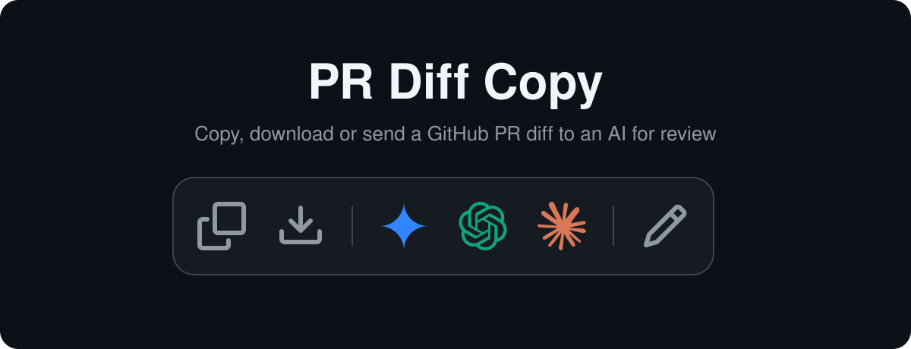

# github-pr-diff-copy

A Chrome extension that adds a small toolbar to every **GitHub pull request** page: copy the diff, download it, or send it to an AI for review.

- **Copy** the diff to the clipboard (fetches `<PR url>.diff`)
- **Download** it as `<repo>-pr-<number>.diff`
- **Review in Gemini / ChatGPT / Claude**: opens the site, attaches the diff as a file and types a review prompt. You press send.
- **Custom review prompt** from the pencil button
- Works on **private repos** (uses your logged-in GitHub session)
- Follows GitHub's light / dark theme
- No analytics, no tracking, no remote code, see [PRIVACY.md](PRIVACY.md)

> [!WARNING]
> This is a **vibe-coded** project. Attaching the diff works by driving each AI site's own upload input / drop zone, so a redesign of those sites can break it. Use at your own risk, **no warranty, no responsibility** for anything it breaks.

## Install

Requires a Chromium-based browser (Chrome, Edge, Brave, Arc).

```bash
git clone https://github.com/njfamirm/github-pr-diff-copy.git
```

1. Open `chrome://extensions` and enable **Developer mode**.
2. Click **Load unpacked** and select the cloned folder.
3. Open any pull request on GitHub. The toolbar appears bottom-right.

Update with `git pull`, then click the reload icon on the extension card.

## Uninstall

Remove it from `chrome://extensions`. Nothing else is left behind.

## How it works

The diff is fetched by the extension's background service worker (GitHub redirects `.diff` to `patch-diff.githubusercontent.com`, which a page script can't read because of CORS). For the AI buttons, the diff is parked in `chrome.storage.local` for up to 60 seconds, a new tab is opened, and a content script on that site waits for the chat box, types the prompt, then attaches the file. It tries the site's file input, then a simulated drop, then a simulated paste, and checks that the file chip really appeared. If nothing works, it shows a message and the diff is still on your clipboard (Ctrl+V). Nothing is ever sent for you.

## DIY with an AI agent

Attach broke after a site update? Give this prompt to Claude Code (or any coding agent):

> The extension in this repo attaches a diff file to the chat box of Gemini / ChatGPT / Claude in `ai.js`, but it no longer works on `<site>`. Open that site, inspect how its composer accepts files (hidden `input[type=file]`, drop zone, or paste), and update the matching method in `ai.js` so the file chip appears. Keep the other methods as fallbacks.

## Credits

UI icons are [GitHub Octicons](https://github.com/primer/octicons) (MIT). Brand icons are from [Simple Icons](https://simpleicons.org) (CC0). Gemini, ChatGPT and Claude are trademarks of their respective owners; this project is not affiliated with them.

## License

MIT
